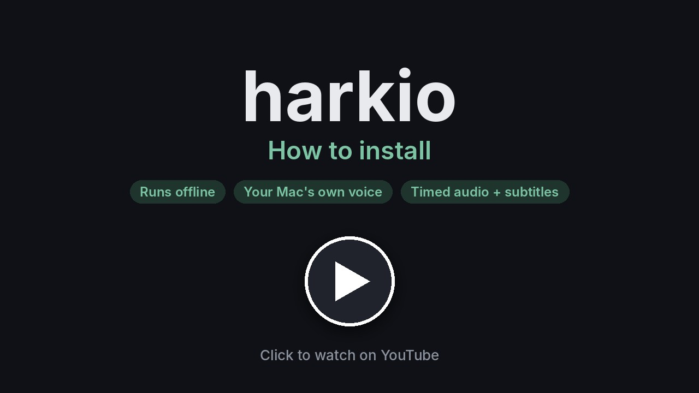
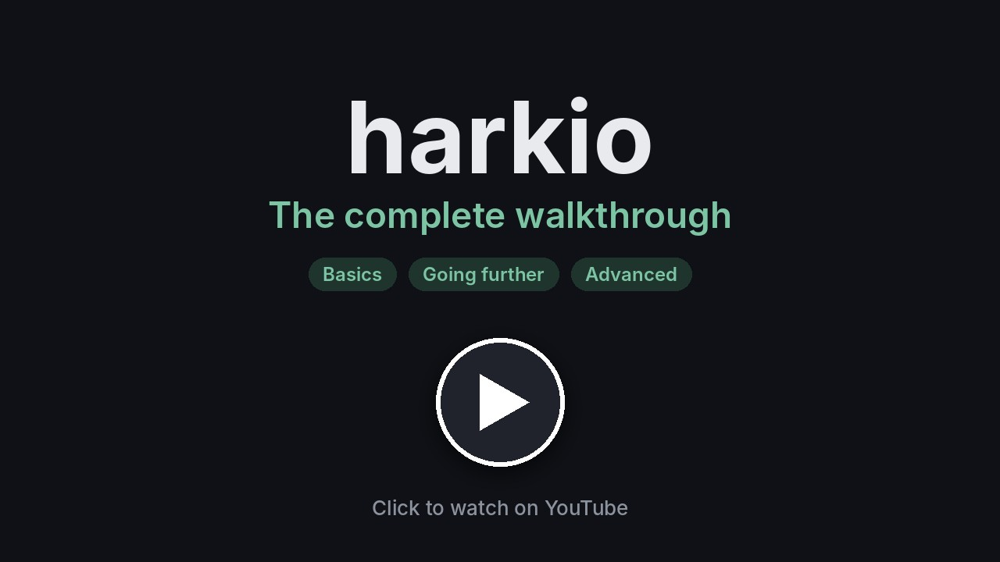

# harkio

Local narration for videos on Apple Silicon Macs. Write a script with timestamps,
and harkio turns it into a timed audio track plus subtitles using your Mac's
System Voice (including Siri voices). Everything runs offline.

## Requirements

- An Apple Silicon Mac (M1 or newer)
- Apple's command line tools, which also provide Python 3. To check if you have
  them, run `xcode-select -p`. If it prints a folder path, you're all set. If you
  get an error instead, install them with `xcode-select --install`.
- macOS 14.2 or later for `harkio record` only

## Install

Watch the install walkthrough on YouTube (narrated with harkio). Click the picture below to play it:

[](https://youtu.be/qdaM55kPdp4)

1. **Pick your voice.** Open System Settings > Accessibility > Read & Speak and
   choose a System voice. harkio speaks with whichever voice you choose here.
   To get more voices, click the info button (ⓘ) next to System voice, then the
   download button next to a voice; the play button lets you hear it first.
   (On macOS versions before Tahoe, this setting is under Accessibility > Spoken Content.)
2. **Get the project from GitHub.** Clone this repository any way you like, then
   open its folder in Terminal.
3. **Run the installer:**

   ```bash
   ./install.command
   ```

   Or double-click `install.command` in Finder. The installer copies harkio to
   `~/.local/share/harkio` and runs it from there, so AI agents and other apps can use
   it even when this folder is somewhere macOS protects, like Documents or Downloads.
   It links `harkio` into `~/.local/bin`, adds that to your PATH for every shell
   (including the ones agents start), and builds the helper tools.

   After you update this folder (for example with `git pull`), run the installer again.
4. **Open a new Terminal window** so the PATH change takes effect, then check
   that it works:

   ```bash
   harkio --help
   ```

5. **Try the example:**

   ```bash
   harkio example
   cd harkio-example && harkio example.txt
   ```

   You'll get a timed narration track (`narration.wav`) and subtitles
   (`narration.srt`) in `harkio-example/example_narration/`.

## Walkthrough

Watch the complete walkthrough on YouTube (narrated with harkio). It covers everything
below, in the same order. Click the picture below to play it:

[](https://youtu.be/nncWIWrdhBQ)

## Basics

### Choose your voice

harkio speaks with your System voice: System Settings > Accessibility > Read & Speak >
System voice (see [Install](#install)). Whichever voice you choose there is the one harkio uses.

### Start a script

```bash
harkio new myvideo.txt
```

This creates `myvideo.txt` from a short template, with a reminder of the syntax at the top.

### Comments and paragraphs

```
# Lines that start with # are comments. They're never read aloud.
[0:00] Welcome back! Today we're building a farm.

[0:12] First, open Godot. Then make a new project.
```

Paragraphs are separated by blank lines.

### Timestamps

A timestamp in square brackets, at the very start of a paragraph, sets when it begins:

```
[0:12] Starts twelve seconds in.

[1:02:30] Hours work for long videos.

[1:05.5] Decimals work for cues between seconds.
```

### Run it

```bash
harkio myvideo.txt
```

harkio renders several sentences at once, then lists each paragraph with its start
and end time. The output goes in `myvideo_narration/` next to your script.

### Use the output

| File | What to do with it |
|---|---|
| `narration.wav` | Put it at the very start of your editor's timeline; every line lands on its cue. |
| `narration.srt` | Import it as captions. |
| `clips/` | One file per paragraph, if you'd rather place them by hand. |

### Learn by example

```bash
harkio example
cd harkio-example && harkio example.txt
```

This creates `harkio-example/` with an example script showing every feature, a
`pronunciations.txt`, and a `README.txt` that tells you what to listen for.

## Going further

### Pauses

`[pause 1s]` or `[pause 400ms]` adds silence anywhere, even in the middle of a sentence:

```
Wait for it. [pause 1s] There it is.
Ready, [pause 400ms] set, [pause 400ms] go!
And a longer one. [pause 2s] Done.
```

### Paragraphs without a timestamp

A paragraph without a timestamp plays right after the one before it, with a short
gap (0.6 seconds). Inside a paragraph, each sentence also gets a small gap
(0.25 seconds). Change them with `--gap` and `--sentence-gap`.

### Speed

`[rate N]` changes the speed from that point on, in words per minute; 175 is normal.
The new speed lasts until you change it again, or write `[rate default]`:

```
[rate 160] This sentence is slower, for a careful step.
[rate 220] This one is faster, for a quick recap.
[rate default] And this one is back to normal.
```

harkio changes speed by stretching the recording afterwards, so it works even with
voices that ignore the Mac's own speed setting.

### Pronunciations

If the voice says a word wrong, add it to a pronunciations file, one `word = how to say it`
per line:

```
Godot = Gaw-doh
GUI = gooey
SQL = sequel
```

Matching ignores capital letters and only replaces whole words. harkio looks for
`pronunciations.txt` next to your script first, then in `~/.config/harkio/pronunciations.txt`,
so one list can cover every script. Fixes change the audio only; the subtitles keep your spelling.

### Inline pronunciations

To change just one spot, write the fix inline as `[word = how to say it]`. The subtitles
keep your word, the voice says your spelling, and it beats `pronunciations.txt` for that spot:

```
I [read = reed] every day, and yesterday I [read = red] two books.
We [live = liv] nearby, and the show is [live = lyve] tonight.
[Wind = Wynd] the clock before the [wind = wind] picks up.
```

### When a paragraph runs late

If a paragraph runs past the next timestamp, the next one starts late instead of
overlapping, and harkio prints a warning so you know which line to trim.

## Advanced

### Options

| Option | What it does |
|---|---|
| `-o`, `--out FOLDER` | where the output goes (default: `<script>_narration` next to the script) |
| `--rate WPM` | overall speed; 175 is normal |
| `--gap SECONDS` | gap between paragraphs without a timestamp (default 0.6) |
| `--sentence-gap SEC` | gap between sentences (default 0.25) |
| `--voice NAME` | a voice by name (default: your System voice) |
| `--pron FILE` | a specific pronunciation file |
| `--jobs N` | sentences rendered at once (default: up to 8) |

```bash
harkio myvideo.txt -o ~/Desktop/myvideo_vo                   # save the output on your desktop
harkio myvideo.txt --rate 150 --gap 1                         # slower, a full second between paragraphs
harkio myvideo.txt --pron ~/shared-words.txt --jobs 4         # shared word list, 4 sentences at a time
```

### Pick a voice by name

`harkio voices` lists the voices you can pick by name. Pass one with `--voice` to use it
for that run only:

```bash
harkio myvideo.txt --voice Samantha
harkio myvideo.txt --voice Daniel
harkio myvideo.txt --voice Moira
```

### harkio rate-test

`harkio rate-test` measures how your voice responds to the Mac's own speed setting.
Some voices barely change, which is why harkio stretches the audio itself.

### harkio record

`harkio record OUT.wav` captures whatever your Mac is playing, straight to a WAV file.
It needs macOS 14.2 or later and permission to record system audio. If you only get
silence, add Terminal under System Settings > Privacy & Security > Screen & System
Audio Recording > System Audio Recording Only.

| Option | What it does |
|---|---|
| `--wait` | don't start writing until sound begins |
| `--stop-after SEC` | stop after SEC seconds of silence |
| `--mute` | keep your speakers quiet while recording |
| `--process NAME` | record just one app |
| `--list` | show which apps are using audio |

```bash
harkio record demo.wav --wait --stop-after 2                     # from the first sound until 2s of silence
harkio record music.wav --process "QuickTime Player" --mute      # just QuickTime Player, speakers muted
harkio record --list                                             # which apps are playing audio right now
```

### setup, help and version

- `harkio setup` rebuilds the helper tools, for speed changes and recording.
- `harkio help` shows every command and option (`harkio help narrate` for the narrate options).
- `harkio --version` prints the version.

## Files

| File | What it is |
|---|---|
| `harkio` | the command |
| `narrate.py` | narration engine |
| `tempo.swift` / `tempo` | pitch-preserving speed changes |
| `harkio-record.swift` / `harkio-record` | system audio recorder |
| `rate_test.py` | speed test |
| `examples/` | sample scripts |
| `assets/` | images for this README |

## License

[MIT](LICENSE) © 2026 NguyenAndrew
